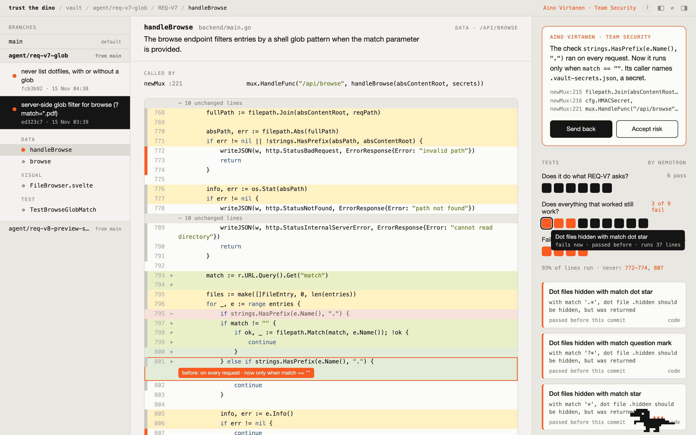
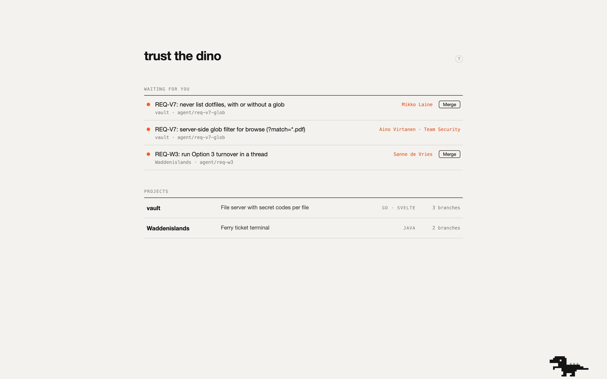
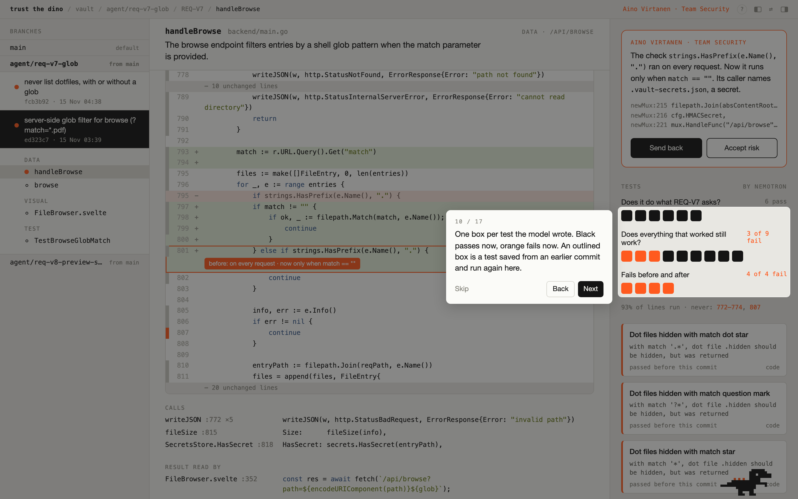

# trust the dino

A merge IDE for agent-written code. It reads your codebase as a graph of functions (who calls what,
where data goes, which layer each one is in) and reviews a commit against it, so a human only looks
at what they have to decide. Built for Junction 2026 (Tieto: Earned Trust in AI Code).



## What it does with a commit

- **Graph diff.** Every function is a node. A change is a set of changed nodes, each shown with the
  real lines that call it, its diff, and the lines that read its result (across Go and Svelte).
- **Routing.** A safety check that runs in fewer cases than before, next to a secret, is not the
  model's to decide: it goes to a named owner with the three lines that matter.
- **Tests written by Nemotron, run on both commits.** What a test means comes from where it passes:
  fails before and passes after proves the requirement; passed before and fails now is a regression.
  Each test knows the exact lines it runs.
- **Tests are kept.** Tests whose intent is trusted are saved per project and run again on later
  commits; a requirement's tests join only after a human merges it.
- **Visual changes** are shown as before/after screenshots of the real app at both commits.
- **The dino** walks along the bottom. Click it to ask about the open commit; it answers only from
  that commit's review and never makes the decision.

## Screens

| | |
|---|---|
|  |  |
| **Home.** What waits on whom, and your projects. | **Visual changes.** The real app at both commits: typing `*` now lists `.vault-secrets.json`. |
|  |  |
| **The fix.** The three tests that caught the leak were saved, and pass on the agent's fix. | **Java.** Same pipeline on Waddenislands: JUnit tests with JaCoCo coverage. |

The first visit starts a short walkthrough of every part of the screen:



## Run

```sh
./samples.sh                      # sample repos: vault (Go + Svelte), Waddenislands (Java)
python3 -m core.serve             # http://localhost:8290
python3 -m core.dossier v7        # rebuild one review (needs NVIDIA_API_KEY in .env)
./test.sh                         # unit tests: Go adapter, Java adapter, Python core
```

Needs Python 3.11+, Go 1.22+, a JDK 17+ and git. Screenshots need `npm install` and
`npx playwright install chromium`. Docker and the public deploy: [DEPLOY.md](DEPLOY.md).

## Layout

| Path | What |
|---|---|
| `adapters/go`, `adapters/java` | one program per language: source dir in, function graph JSON out |
| `core/graphdiff.py` | compares two graphs: changed nodes, checks that moved, routing |
| `core/testgen.py`, `core/lang/` | test generation loop; per-language runners (go test, JUnit + JaCoCo) |
| `core/store.py` | the saved test suite and what may enter it |
| `core/dossier.py` | one commit's review as JSON (`dossier/`) |
| `core/serve.py` | the app server: static files, chat, decisions, adding projects |
| `web/` | the app: plain ES modules, no build step |
| `input/<case>/` | requirement, owners and agent patch for each sample commit |

Concept, decisions and limits: [PLAN.md](PLAN.md).
