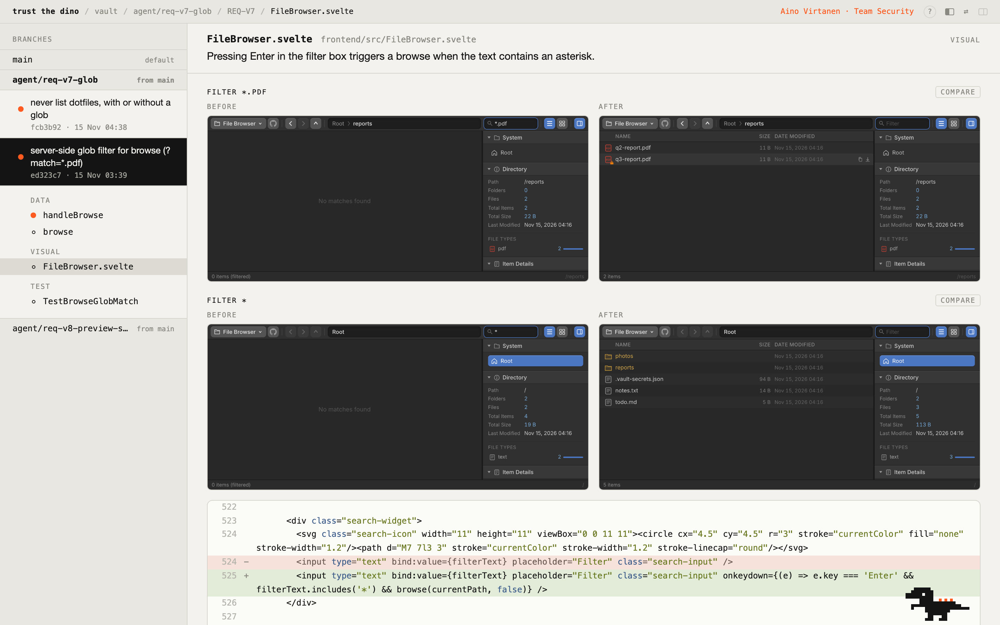
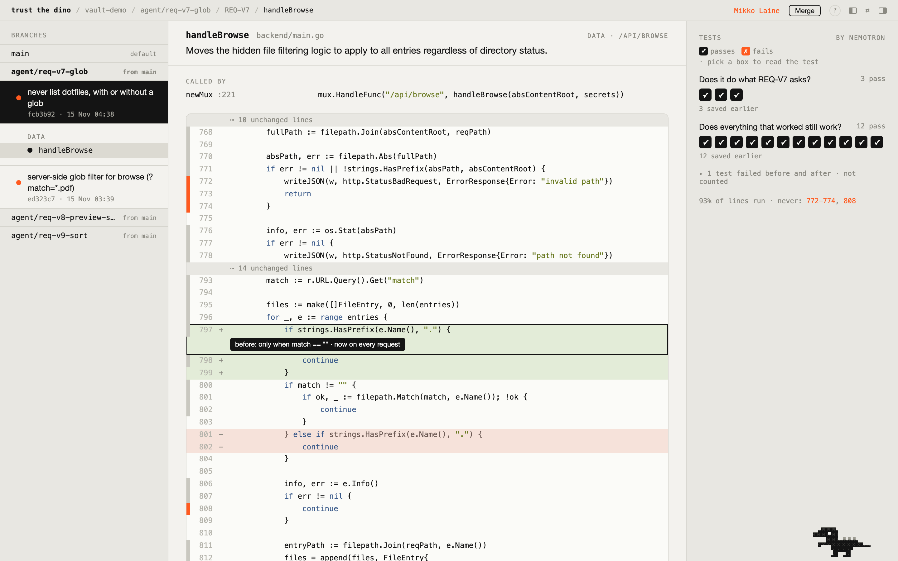
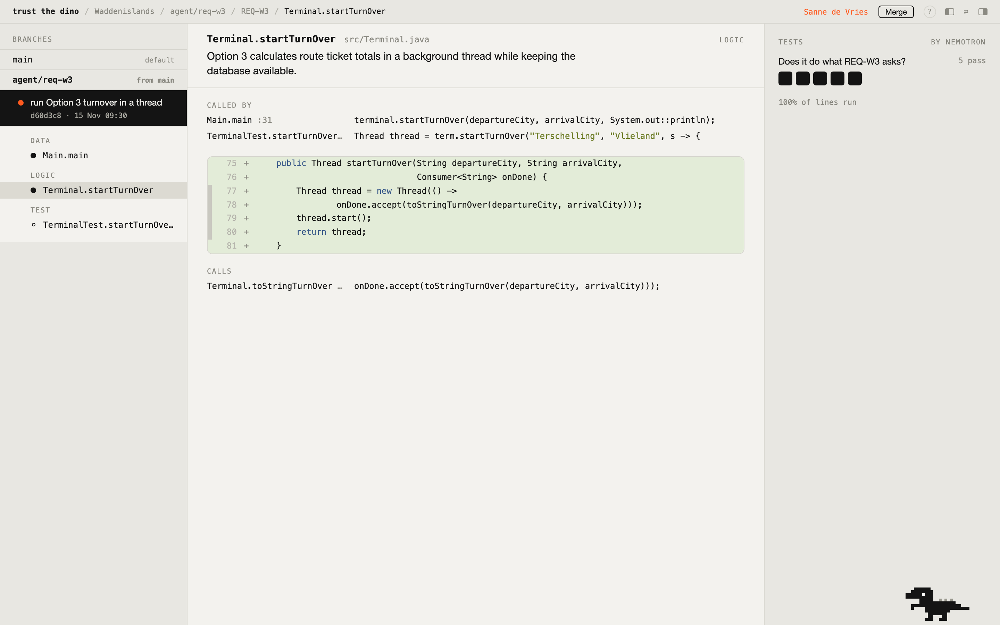

# trust the dino

**Your agent changed 800 lines. You read 3.**


**[Live demo](https://dino.umarbek.dev)** · **[Promo film (70 s)](video/promo/promo.mp4)** · **[Demo walkthrough (116 s)](video/trust-the-dino.mp4)** · **[Deck (PDF)](presentation/trust-the-dino.pdf)** · **[Measurement](docs/MEASUREMENT.md)**

A code-review engine for agent-written code. It understands the codebase before it looks at the change,
proves the safe parts with tests that run on both commits, and hands a named person only what a rule
says the AI may not decide. Built for Junction 2026 (Tieto: Earned Trust in AI Code) with NVIDIA Nemotron.

## The interface is the easy part

The review screen is calm: one changed function, the lines that call it, its diff, the lines that use its
result, and its tests. Underneath is an IDE-like engine:

- **A semantic graph.** Language adapters (Go through `go/ast`, Java, Svelte split per function) turn a
  repository into a graph. Every function and component is a node with a layer (logic, data, visual,
  test); edges are calls, data reads and writes, and literals. Secrets like `.vault-secrets.json` and
  `Config.HMACSecret` are labelled, and the labels travel along the edges.
- **A graph diff, not a text diff.** A commit becomes the set of changed nodes, each with its callers'
  lines, its diff and its consumers' lines, even across languages: a Go route is linked to the Svelte
  `fetch()` calls that use it.
- **Guard analysis.** Every condition that exits early is compared across both commits, so the engine
  knows structurally when a check now runs in fewer cases.
- **Tests that mean something.** Nemotron writes tests grounded in real call sites and the requirement,
  with a compile and coverage feedback loop. Every test runs on the commit before and the commit after:
  fails before and passes after proves the requirement; passed before and fails now is a regression;
  fails on both is shown and not counted. Trusted tests are saved and re-run on later commits.
- **Rules, not vibes.** A narrowed check next to a secret, changed lines that read or write a secret,
  fewer calls to an auth function, or security code goes to a named owner from `owners.json`.
  Everything else merges on evidence.
- **Pixels for the UI.** The real app is built and run at both commits; scenes are replayed and shown
  side by side, as a compare slider, or as a pixel diff.

## The demo: four agent commits on vault

| Commit | What the engine finds | Result |
|---|---|---|
| REQ-V8 · file size in the preview | before/after of the real app, no rule touched | ✓ merged |
| REQ-V9 · sort the file list | 26 of Nemotron's 32 tests fail before and pass after; 100% of the new function runs | ✓ merged |
| REQ-V7 · glob filter | every test green, but `?match=*` lists `.vault-secrets.json`: the dotfile check now runs only when `match == ""` | ✗ routed to Aino Virtanen, Team Security, with 3 lines and 3 tests that passed before and fail now |
| REQ-V7 fix | the same saved tests now pass | ✓ merged |

Three changes clear on evidence. One is stopped by a rule and decided by a person who read three lines.

## Measured

25 single-edit mistakes seeded into vault, 17 of them risky. The repo's own tests catch **5/17**; our
first rules caught **9/17**; the current rules catch **17/17** with **2/8** harmless changes flagged.
Those rules were written after seeing the misses, so the number is fitted to this set. Details and every
mutant: [docs/MEASUREMENT.md](docs/MEASUREMENT.md).

## Screens

| | |
|---|---|
|  |  |
| **The catch.** The moved check, the three lines Security reads, and the tests that passed before and fail now. | **Visual changes.** The real app at both commits: typing `*` now lists `.vault-secrets.json`. |
|  |  |
| **The fix.** The tests that caught the leak were saved, and pass on the agent's fix. | **Java.** Same pipeline on Waddenislands: JUnit tests with JaCoCo coverage. |

Also in the app: a day and night theme with a pixel sun and moon, the test run playing as it happened,
a phone layout with Change / Tests / Decide tabs, and **the dino**, who lives at the bottom of the screen,
turns orange when something waits on you, and answers questions from the open commit's review only.
It never presses merge.

## Run

```sh
./samples.sh                      # sample repos: vault (Go + Svelte), Waddenislands (Java)
python3 -m core.serve             # http://localhost:8290
python3 -m core.dossier v9        # rebuild one review (needs NVIDIA_API_KEY in .env)
python3 tools/measure.py          # the seeded-mistake measurement (no model calls)
./test.sh                         # unit tests: Go adapter, Java adapter, Python core
```

Needs Python 3.11+, Go 1.22+, a JDK 17+ and git. Screenshots, the film and the deck need `npm install`
and `npx playwright install chromium`. Docker and the public deploy: [DEPLOY.md](DEPLOY.md).

## Layout

| Path | What |
|---|---|
| `adapters/go`, `adapters/java`, `adapters/svelte` | one program per language: source in, function graph out |
| `core/graphdiff.py` | compares two graphs: changed nodes, guard changes, routing rules |
| `core/testgen.py`, `core/lang/`, `core/runners.py` | test generation loop; per-language runners (go test, JUnit + JaCoCo) |
| `core/store.py` | the saved test suite and what may enter it |
| `core/visual.py`, `core/shots.mjs` | builds and runs the app at both commits, replays scenes |
| `core/dossier.py` | one commit's review as JSON (`dossier/`) |
| `core/serve.py` | the app server: static files, chat, decisions, adding projects |
| `web/` | the app: plain ES modules, no build step; WebGL shaders for the dino and the pixel diff |
| `input/<case>/` | requirement, owners and agent patch for each sample commit |
| `video/`, `presentation/` | the films and the deck, rendered from code |

Concept, decisions and limits: [CONCEPT.md](CONCEPT.md), [PLAN.md](PLAN.md), [LESSONS.md](LESSONS.md).
